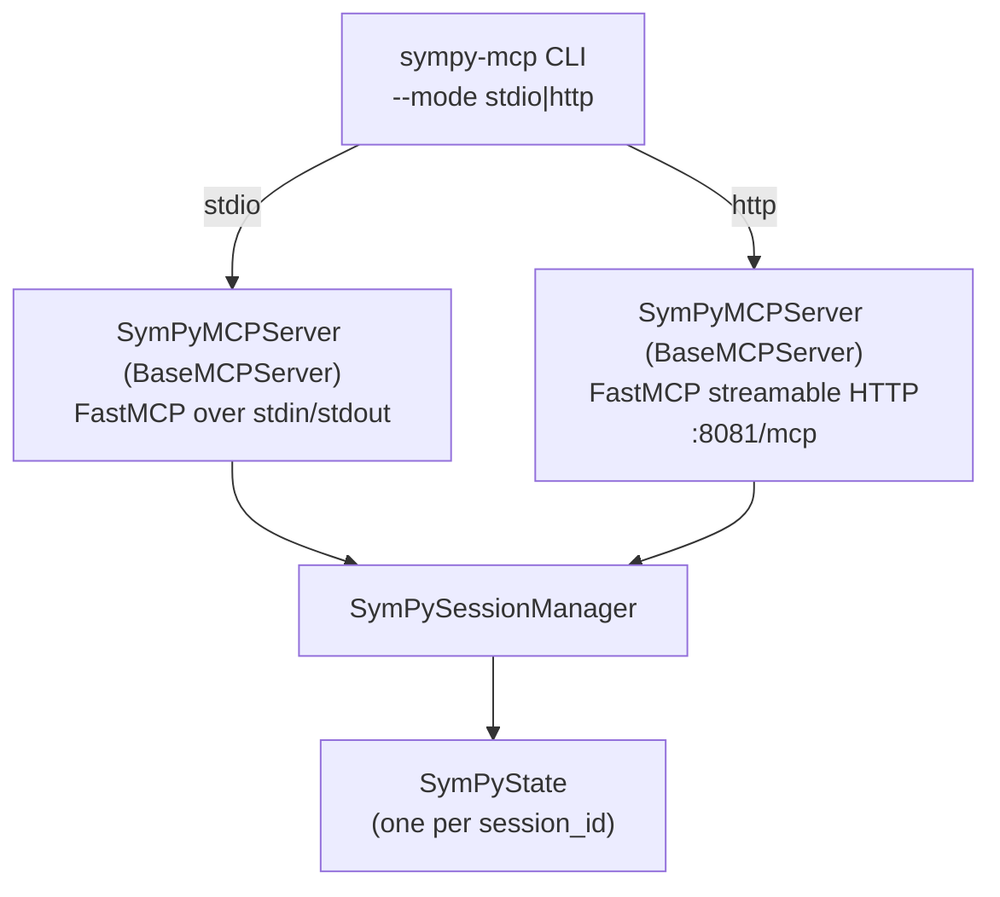
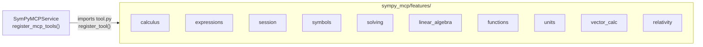
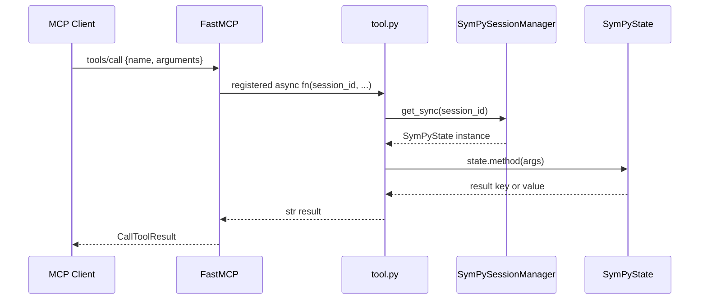
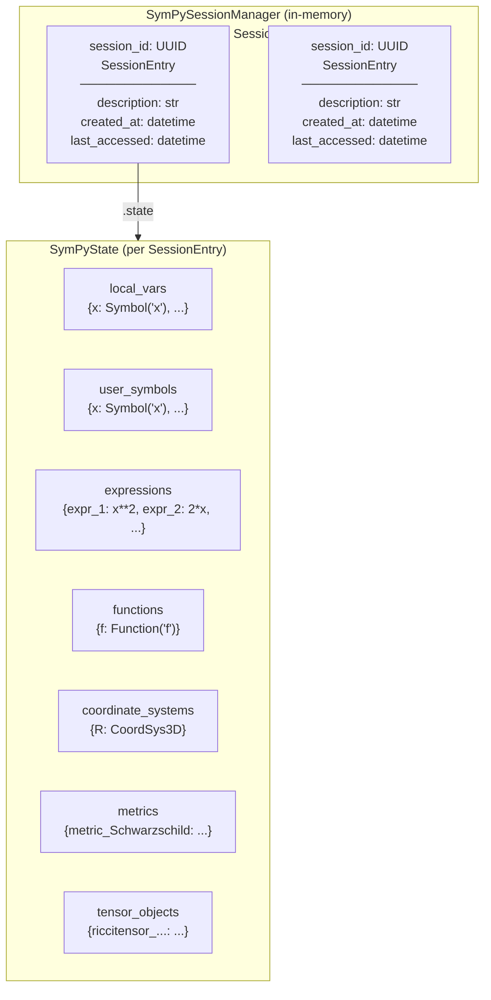
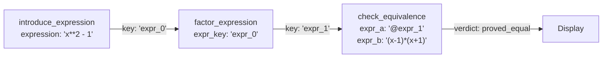
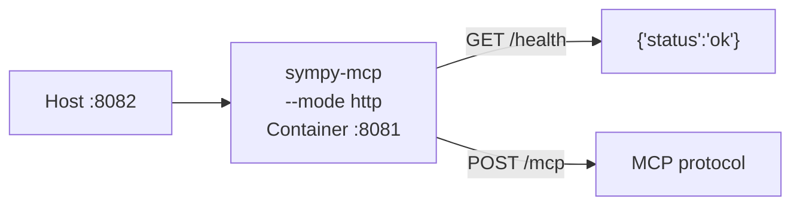

# Architecture

## Overview

`sympy-mcp` exposes a symbolic math engine to AI clients over the Model Context Protocol. The server framework comes from [mcp-service-kit](https://github.com/geosp/mcp-service-kit): it provides the stdio and streamable-HTTP transports, the standard CLI, and environment-based configuration.

The entrypoint is the `sympy-mcp` CLI (`sympy_mcp/server.py:main`, built with `create_main_with_modes`), which selects a transport at startup. All symbolic computation happens in `SymPyState` (one instance per session), managed by `SymPySessionManager`.

---

## Transport Modes



| Mode | Transport | Endpoint | Use case |
|------|-----------|----------|----------|
| `stdio` | stdin/stdout | — | Claude Desktop, Cursor, subprocess clients |
| `http` | HTTP | `:8081/mcp` | Cline, HTTP-capable MCP clients, Docker |

A `/health` custom route is registered on the FastMCP instance via `@mcp.custom_route()` (in `sympy_mcp/service.py`), so HTTP deployments can be health-checked.

### Configuration

`sympy_mcp/config.py` defines `AppConfig`, a pydantic-settings model with two sections. The kit's `main()` loads `.env` first, then applies CLI flags on top.

| Section | Class | Environment variables |
|---------|-------|-----------------------|
| `server` | `SymPyServerConfig` (extends the kit's `BaseServerConfig`) | `MCP_TRANSPORT`, `MCP_HOST`, `MCP_PORT` (default `8081`), `MCP_AUTH_ENABLED` (default `false`) |
| `sympy` | `SymPyConfig` | `SYMPY_SESSION_TTL` (default `1800`) |

The server has no auth provider. Authentication is expected at the gateway in front of it. Setting `MCP_AUTH_ENABLED=true` makes HTTP mode refuse to start (mcp-service-kit ≥ 0.2 fails closed when auth is enabled without a provider), rather than serve without authentication.

---

## Feature Module Structure

Each capability area is a Python package under `sympy_mcp/features/`. Every feature follows the same two-file convention:

```
sympy_mcp/features/<feature>/
├── instructions.md # Tool descriptions loaded into MCP docstrings at runtime
└── tool.py         # MCP tools — register_tool(mcp, session_manager)
```

`tool.py` is **auto-discovered** at startup by `SymPyMCPService.register_mcp_tools()` — no manual registration needed when adding a new feature.



### Adding a new feature

1. Create `sympy_mcp/features/<name>/` with `__init__.py`, `instructions.md` and `tool.py`
2. Write tool descriptions in `instructions.md` — these are injected as MCP docstrings at runtime
3. Implement `register_tool(mcp, session_manager)` in `tool.py`
4. Add the computation method to `SymPyState` in `sympy_mcp/state.py`

---

## Request Flow

### MCP tool call (stdio or HTTP)



---

## Session and State Model

Each unique `session_id` maps to a `SessionEntry` (metadata + an isolated `SymPyState` instance). Sessions must be explicitly created via the `create_session` tool, which returns a server-generated UUID. Unknown session IDs are rejected with a `SessionNotFoundError`.

`get_sync()` updates `last_accessed` on every call, enabling future TTL-based eviction (configured via `ttl_seconds` at startup, default 1800 s).



**Key rules:**
- All tool calls sharing state **must** use the same `session_id` — different IDs are completely isolated namespaces
- Session IDs are server-generated UUIDs — clients cannot choose their own
- `user_symbols` tracks only explicitly introduced symbols (via `intro`/`intro_many`); `local_vars` also includes unit constants loaded at init
- Most computation methods return a **key** (e.g. `"expr_3"`) that is stored in `expressions` — pass this key as `expr_key` in subsequent tool calls
- `get_sync()` (used by all tools) touches `last_accessed`; `get()` (async, returns `None` on miss) is available for non-tool code

---

## Result Key Pattern

Computation tools use a key-based chaining pattern to avoid serializing large symbolic expressions across tool calls. Every computing tool stores its result and returns `{"key", "result", "latex"}`:



- `key` — session storage key, for chaining into the next tool call or for `@key` references inside expression strings
- `result` — the stored value as a SymPy string
- `latex` — the stored value in LaTeX

Internally, `SymPyState` computing methods return a `StoredResult` (`sympy_mcp/results.py`): a `str` equal to the tool's legacy return value that also carries the key and value. The tool wrapper renders it with `format_output()` according to `output_format` (`"structured"` by default, or `"legacy"`).

The `series_expansion` tool stores the polynomial without the big-O term under `key`, and adds the full series with O() notation as `series` / `series_latex` for display.

---

## Transcripts and Export

`SymPyMCPServer.create_middleware()` installs `TranscriptMiddleware` (`sympy_mcp/transcript.py`). For every tool call that names a `session_id`, it appends `{tool, arguments, result}` (or `error`) to that session's `SymPyState.transcript`. The session bookkeeping tools are not recorded. `export_session` renders the transcript as JSON, or as a Python script that replays the calls against a fresh in-process server and compares every result with the recorded one.

---

## Docker Compose Service



The container is built from the `Dockerfile`. Dependencies are pre-installed at build time via `uv sync --frozen --no-dev`, so startup is instant with no network access required.
